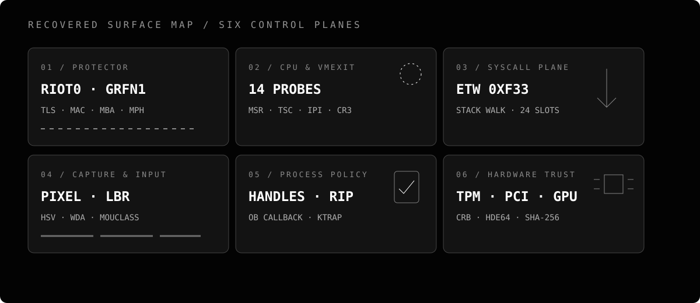
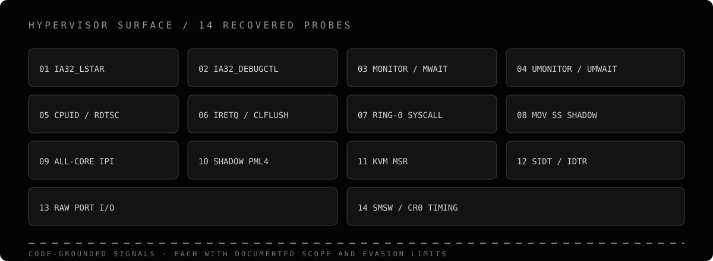
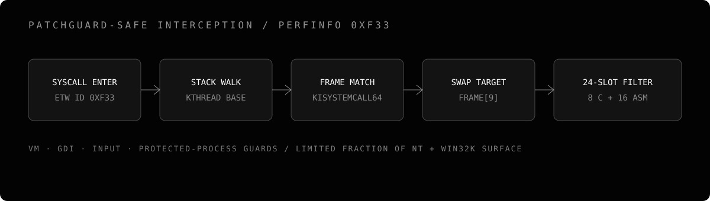
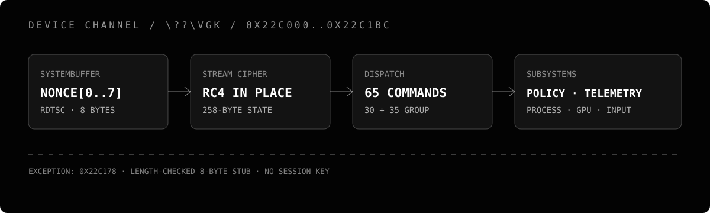

# Riot Vanguard · Detection Vector Breakdown

> Original independent reverse engineering by **hexreys**. Every address, count, limitation, reconstructed routine, telemetry code, and IOCTL observation in this repository is tied to the analyzed build shown below.

`vanguard/1.19.1-18+20261001.143443` · `vgk.sys` · `vgc.exe` · Windows x64

[Protection](#1-self-protection--obfuscation) · [VM-exit probes](#2-hypervisor-vmexit--cpu-timing-probes-14) · [ETW hooks](#3-patchguard-safe-etw-0xf33-stack-walking-hooks-24-slots) · [Capture and input](#4-colorbot-pixel-poisoning--stream-proof-overlay-detection) · [Policy](#7-process-protection-handle-stripping--policy-blob) · [Catalogs](#9-master-reference-complete-telemetry-event-catalog--full-65-command-ioctl-list)

| Surface | Recovered result |
|---|---:|
| Stage-5 solved sites | **8,868 / 8,868** |
| Entry stubs mapped | **462 / 466 vgk** · **1,036 / 1,080 vgc** |
| ETW syscall-hook slots | **24** |
| Hypervisor and timing probes | **14** |
| Documented telemetry codes | **68** |
| Valid IOCTL switch commands | **65** |
| Lazy kernel API resolvers | **313** |
| Unique resolved kernel APIs | **246** |



## Repository map

```text
.
├── README.md                 complete structured research notebook
├── research-notes.txt        untouched source notes supplied by the researcher
├── vgk_catalog.py            offline event / IOCTL / keyword explorer
├── research-manifest.json    build identity and headline measurements
├── banner.svg                repository identity
├── surface-map.svg           recovered subsystem map
├── stage5-coverage.svg       Stage-1 and Stage-5 coverage
├── vmexit-probes.svg         fourteen-probe taxonomy
├── etw-pipeline.svg          0xf33 stack-walk interception path
├── ioctl-channel.svg         RC4 framing and 65-command dispatch
├── telemetry-map.svg         68-code family breakdown
└── LICENSE
```

The Markdown notebook below preserves the full technical content. `research-notes.txt` is retained byte-for-byte so the original research record remains available independently of presentation changes. The included CLI reads that source file directly; it does not require proprietary binaries or network access.

### Offline catalog

```powershell
python vgk_catalog.py summary
python vgk_catalog.py events --family 0xb000
python vgk_catalog.py events --query "debug port"
python vgk_catalog.py ioctls --query 0x22c178
python vgk_catalog.py search MouClass
```

`summary` prints the build-pinned research manifest. `events` and `ioctls` expose the master catalogs, while `search` deliberately scans every line of the untouched notebook so grouped codes and prose-only observations remain discoverable.

## Complete technical notebook

## 1. Self-Protection & Obfuscation
Packer & Self-MAC (.riot0 / .riot1): vgc.exe runs a TLS callback before main (magic 0xb007) that decrypts 8 regions and rebuilds the protected IAT: 334 Type-A return-checked thunks + 23 Type-B direct syscalls = 357 slots across 15 DLLs. vgk.sys's .riot0 region table has 12 entries with 24-byte (192-bit) MACs; the protector's full MAC/key schedule is not yet recovered.
.grfn1 Dispatcher & Branchless MBA Muxes: Indirect jumps use the 6-stage MBA + FNV-1a + CHD minimal-perfect-hash dispatcher. The repo maps 462/466 (99.1%) entry stubs in vgk.sys and 1,036/1,080 (95.9%) in vgc.exe. Those are Stage-1 entry-stub reachability numbers. Junk bytes (f2 dc 71 74) are padded after E9/0F 8x terminators to break linear sweep. Conditional branches save RFLAGS (pushfq; pop [rsp+0x650]) and enter 20–25 KB Upper .grfn1 blocks with zero Jcc, blending targets via bitwise MBA masks.
Stage-5 coverage: A full machine-level sweep decoded 8,868/8,868 solved sites (1,935 vgk + 6,933 vgc) with 0 unresolved: 812,521 vgk Stage-5 instructions + 1,368 inner-call targets; 692,922 vgc Stage-5 instructions + 29,557 inner targets. It found 2 vgk / 6 vgc privileged-instruction candidates and 102 vgk / 858 vgc documented event-code candidates. Unicorn probes of two candidate blocks executed 1,200 instructions without hitting a privileged instruction, so those remain linear-disassembly candidates, not path-confirmed. The Stage-5 blocks are mostly MBA/branch/marshalling code; the actual probes may live in called .text/.stub0 functions or on paths not taken by a zeroed VM context.
Egg & Egg2 exports: Both exports exist; Egg2 performs dxgkrnl.sys HDE64 GPU fingerprinting. The export interface is a real surface distinct from the normal IOCTL path.
.NT kernel imports: 313 lazy resolver functions populate a 2-slot ping-pong table for 246 unique kernel APIs across 1,235 slot addresses. Each slot stores a 64-bit rdtsc-derived XOR key plus two encrypted pointer slots. The key is derived from rdtsc() and the resolved pointer, not a secret; the old slot is not wiped, and refresh/failure behavior is partial.
RC4 IOCTL channel (\??\vgk): 64 of 65 IOCTLs (0x22c000..0x22c1bc) are encrypted in place with RC4 using an 8-byte rdtsc nonce at SystemBuffer[0..7] and a 258-byte base state. The confirmed 73-byte RC4 KSA at 0x1400183cc is the "Congrats, you found something..." string. 0x22c178 is a length-checked stub: in_len >= 8, bytes_ret = 8; it does not establish a session key.




## 2. Hypervisor (#VMEXIT) & CPU Timing Probes (14)



IA32_LSTAR (MSR 0xC0000082) write/restore: Under cli, writes a dummy stub to 0xC0000082 and restores the original. The recovered 0x140002b50 path does not read back and has no SEH; it logs 0xb0000001 through a one-shot latch. A separate write/readback variant exists in the wider probe set. A silently emulated WRMSR can pass the write/restore path.
IA32_DEBUGCTL (MSR 0x1D9) bit-flip: Toggles bits 0/1 and reads back. The recovered predicate is true when readback == pre-write, i.e. when the write was ignored. Only bits 0–1 are tested; LBR depth is not.
MONITOR + CPUID(1) + MWAIT: The decompiled body at 0x140003284 is monitor(); cpuid(1); mwait();. The 100-cycle rule is a heuristic, not present in the recovered body. AMD SVM can skip the CPUID intercept, and monitor clearing after a VM exit is not architecturally guaranteed.
UMONITOR + CPUID(1) + UMWAIT CF: Compares UMONITOR→UMWAIT (CF=1 on deadline) with UMONITOR→CPUID(1)→UMWAIT (CF=0 on early disarm). WAITPKG is Intel-only; AMD lacks it, and some BIOSes disable it. A hypervisor that traps UMWAIT can return the expected CF.
Paired CPUID(1) + RDTSC ratio: Compares CPUID→RDTSC→CPUID→RDTSC with CPUID→CPUID→RDTSC→RDTSC. Catches constant TSC_OFFSET subtraction but is defeated by TSC scaling/compensation and is noisy under SMT/load.
IRETQ + CLFLUSH [rsp] + CPUID(1): Forges a 5-QWORD IRETQ frame, flushes [rsp], executes CPUID(1), and measures cache-reload latency. The hypervisor does not necessarily touch the guest stack line during a VM exit; the signal is small and noisy.
Ring-0 SYSCALL: 0x1400010a0 executes syscall in ring 0; the int 0x20 stub at 0x14000109d is also present.
MOV SS interrupt-shadow probe: Executes mov ss, [rdx]; rdmsr after a 24-instruction ALU dependency chain, testing whether a hypervisor honors the MOV SS interrupt shadow.
All-core KeIpiGenericCall RDTSC sweep: Broadcasts an IPI across all cores to run synchronized RDTSC + CPUID(1) loops, defeating single-core hyperjacking and vCPU migration. It is also a latency/availability probe.
Shadow-PML4 CR3 + CR4.PGE flush: Inside the IPI, swaps CR3 to a custom contiguous PML4 and toggles CR4.PGE (bit 7) to time full EPT/NPT TLB flushes.
KVM synthetic MSR 0x4B564D00: Reads the Linux KVM wall-clock MSR inside an SEH. Catches KVM/QEMU with kvm=off but the synthetic MSR handler still enabled. KVM can disable the MSR; Hyper-V/Xen/VMware are not covered.
SIDT IDTR inspector: Reads the IDTR base/limit. SIDT is routinely virtualized; the probe has no documented expected baseline and can false-positive on security products that relocate the IDT.
Raw port I/O: Executes in al/ax/eax, dx for widths 1/2/4. A hypervisor can emulate the port; unhandled ports raise #GP. The probe is low-specificity.
SMSW / CR0 machine-status word: Executes smsw + rdtsc timing. A weak CR0/timing consistency check, not a reliable VM-exit detector.

## 3. PatchGuard-Safe ETW (0xf33) Stack-Walking Hooks (24 Slots)
Instead of patching the SSDT or W32pServiceTable, Vanguard enables ETW hook ID 0xf33 (PERFINFO_LOG_TYPE_SYSCALL_ENTER) via NtTraceControl. On every syscall it walks the current thread's kernel stack up to KTHREAD.StackBase (SystemReserved1[0x13]), matches the 0xf33 marker and the KiSystemCall64 return address, and rewrites the spilled syscall target pointer at the frame[9] slot.



### Reconstructed ETW stack-walker shape

```c
// Reconstructed shape, not original source.
uint8_t VgkEtwStackWalker(uint64_t *current_rsp, uint64_t etw_magic_tag) {
    uint64_t *stack_base = (uint64_t *)g_CurrentThread->StackBase; // KTHREAD.StackBase
    for (uint64_t *scan = current_rsp; scan < stack_base; scan += 2) {
        if ((uint16_t)scan[0] == ((etw_magic_tag >> 32) & 0xFFFF) &&
            ((scan[2] ^ etw_magic_tag) & 0xFFFFF) == 0) {
            for (uint64_t *frame = (uint64_t *)(scan + 4); frame < stack_base; frame++) {
                if (*frame >= g_KiSystemCall64Start && *frame < g_KiSystemCall64End)
                    return VgkSwapSyscallTarget(stack_base, &frame[9]);
            }
            return 0;
        }
    }
    return 0;
}
```

The 24-slot dispatcher is confirmed: 0x1400cd958 compares 24 globals and routes through 8 C hooks plus 16 assembly trampolines. The code-grounded 24-slot table covers the VM, GDI, input, and protected-process guards. Scope weakness: 24 slots is a small fraction of the NT/win32k surface; unhooked syscalls, kernel-direct calls, and a restored HalPrivateDispatchTable bypass the filter.
Virtual memory: NtAllocateVirtualMemory, NtFreeVirtualMemory, NtProtectVirtualMemory, NtMapViewOfSection, NtReadVirtualMemory, NtWriteVirtualMemory. Executable requests check the caller's user-mode RIP; unbacked callers log 0xb0000121 and have execute bits stripped.
GDI/input: NtGdiBitBlt, NtGdiStretchBlt, NtGdiGetPixel, NtUserSendInput, NtUserMessageCall, NtUserPostMessage, NtUserPostThreadMessage, NtUserSetWindowsHookEx, NtUserGetDC, NtUserQueryWindow, NtCreateSection.
Protected-process guards: four slots consult the 32-entry protected-process table and return 0xC0000022 for unauthorized callers.


## 4. Colorbot Pixel Poisoning & Stream-Proof Overlay Detection
NtGdiGetPixel active HSV jitter: When a non-whitelisted caller invokes NtGdiGetPixel, Vanguard records capture telemetry and perturbs the returned color: RGB→HSV, RtlRandomEx seeded from KUSER_SHARED_DATA.TickCountLow (0xFFFFF78000000014), hue ±1–10%, saturation ±5–10%, value ±4–10%, then HSV→RGB. This is narrow: BitBlt, StretchBlt, PrintWindow, GetDIBits, DWM/DXGI Desktop Duplication, Windows.Graphics.Capture, and hardware capture return unpoisoned pixels. Repeated sampling also averages out the bounded perturbation.
Stream-proof overlay (SysDispAffinity) scanner: Walks the win32k window table and selects build-specific display-affinity offsets from NtBuildNumber (the code-grounded range is 0x42EE..0x6659). It checks internal flag bits 0x08 (WDA_MONITOR) and 0x40 (WDA_EXCLUDEFROMCAPTURE). If the kernel flags say "excluded" but the SysDispAffinity property is missing/zeroed, it records the overlay HWND. DirectComposition/hardware overlays and new builds remain blind spots.

### Reconstructed GetPixel hook shape

```c
// Reconstructed shape, not original source.
uint32_t HkNtGdiGetPixel(HDC hdc, int x, int y) {
    uint32_t color = OrigNtGdiGetPixel(hdc, x, y);
    PEPROCESS proc = PsGetCurrentProcess();
    if (!IsWhitelistedCaller(proc)) {
        int coords[4] = { x, y, x, y };
        VgkLogGdiCapture(proc, 7, coords); // Telemetry type 7 = GetPixel
    }
    uint8_t r = color & 0xFF, g = (color >> 8) & 0xFF, b = (color >> 16) & 0xFF, h, s, v;
    RgbToHsv(r, g, b, &h, &s, &v);
    ULONG seed = *(volatile ULONG *)0xFFFFF78000000014ULL;
    int dh = ((RtlRandomEx(&seed) % 10 + 1) * h) / 100;
    h += (RtlRandomEx(&seed) & 1) ? dh : -dh;
    int ds = ((RtlRandomEx(&seed) % 6 + 5) * s) / 100;
    s = ClampByte((RtlRandomEx(&seed) & 1) ? (s + ds) : (s - ds));
    int dv = ((RtlRandomEx(&seed) % 7 + 4) * v) / 100;
    v = ClampByte((RtlRandomEx(&seed) & 1) ? (v + dv) : (v - dv));
    return ReconstructJitteredColor(h, s, v);
}
```

## 5. Input Integrity & Hardware LBR Callstack Walks
NtUserSendInput in-place scrubbing: Iterates the caller's 40-byte (0x28) INPUT array, strips synthetic inputs in place, zeroes the tail, and decrements cInputs. The filter is partial: raw input, WM_INPUT, WM_MOUSEMOVE, custom messages, keybd_event/mouse_event, UIAutomation, and driver-level injection are not the same boundary.
Window message filtering: Blocks selected keyboard (0x100..0x105) and mouse (0x201..0x20C) messages in PostMessage/SendMessageCallback/PostThreadMessage.
MouClass/MouHid + CPU LBR: Hooks \Driver\Mouclass and records 150,000 mouse packets in a 6 MB 'MouC' non-paged ring. The callback reads the hardware LBR — Intel MSR 0x1C9 (TOS) + 0x680 base; AMD MSR 0x1DB — to expose the branch source (FROM_IP). Key weaknesses: one LBR entry per capture, per-CPU, virtualizable, and a shaped call stack can hide the injection origin. Hardware input (KMBox/Arduino/USB HID) is physically indistinguishable at MouClass; the ring can be flooded and overwritten.


## 6. Executable Memory & KTRAP_FRAME RIP Verification
When NtAllocateVirtualMemory, NtProtectVirtualMemory, or NtMapViewOfSection is called with executable permissions (Protect & 0xF0 != 0), Vanguard walks the kernel stack to the KTRAP_FRAME and checks the saved user-mode RIP. The check resolves the RIP to a module/section backing; it is not a module-hash check. Module stomping (overwriting code inside a legitimate image section), ROP/JOP to a legitimate module before the syscall, JIT regions, and thread/APC/context injection can therefore pass. Unbacked callers log 0xb0000121 and have execute bits stripped.

### Reconstructed executable-memory caller check

```c
// Reconstructed shape, not original source.
for (uint64_t *slot = (uint64_t *)_AddressOfReturnAddress(); slot < stack_base; slot++) {
    if (*slot == g_KTrapFrameSignature) {
        uint64_t user_rip = slot[3]; // saved user-mode RIP in KTRAP_FRAME
        if (!IsRipInBackedModuleOrSection(user_rip))
            VgkLogTelemetryEvent(4, 0xb0000121, &GUID_EXEC_MEM_ANOMALY, SyscallSubcode);
        break;
    }
}
```

## 7. Process Protection, Handle Stripping, & Policy Blob
Process integrity & 0xC0000EEE kill: Process classification uses SeLocateProcessImageName, debug-port state, and signature/section metadata. 0xb000016b is the SeRegisterImageVerificationCallback failure path that terminates vgc.exe (tier 7). The game process is tier 6 with mask 0x21fdf.
ObRegisterCallbacks & ExEnumHandleTable: The callback checks that the caller return address is inside ntoskrnl, exempts self/kernel/werfault.exe, and strips access. The process mask is ~0x3A normally, but ~0x2A when the target matches the trusted-process predicate — that leaves PROCESS_VM_READ (0x10) intact. The thread mask is conditional ((-(trusted) & 9) - 0x1A). PROCESS_DUP_HANDLE (0x40), PROCESS_QUERY_INFORMATION (0x400), and several THREAD_* rights are not covered.
Trusted-name skip: FUN_140125bd4 treats csrss.exe, lsass.exe, wininit.exe, services.exe, autochk.exe, chkdsk.exe, and chkntfs.exe as trusted by case-insensitive image name. FUN_14000dca8 feeds that result into the predicate used to skip processes during the retroactive ExEnumHandleTable sweep. A process that controls its image name can avoid the sweep if the other checks pass.
Policy blob: 0x20018 = 131,096 bytes (128 KiB). The loader RC4-decrypts it and compares a 16-byte xxHash-family digest (FUN_140051e5c / FUN_1400540fc). The blob also contains a key/certificate usage/expiry table at +0x18 (0x14016f098), with usage flags at +0x18 and an expiry window of 0x58028E44000 (100 ns ≈ 7 days).


## 8. Hardware, DMA, Bare-Metal TPM 2.0, & BCD / User-Mode Audits
PCI configuration scan: The driver reads PCI configuration space via HalGetBusDataByOffset. A config-space scan is a detection aid, not a DMA firewall; it cannot see DMA that is already mapped by a malicious device.
Bare-metal TPM 2.0 CRB: 0x140152c60 implements CRB MMIO: CRB_CTRL_REQ +0x40, CRB_CTRL_STS +0x44, CRB_CTRL_START +0x4C, DATA_BUFFER +0x80, with a 0xF80-byte command buffer. This is a transport, not an attestation quote: the docs do not identify a nonce, AK, TPM2_Quote/PCR_Read, or response-signature policy. An fTPM, hypervisor-emulated CRB, or hardware interposer can satisfy the transport.
HDE64 dxgkrnl fingerprinter: Egg2 resolves DxgkEnumAdapters2/DxgkQueryAdapterInfo by xxHash64, follows the first E8 rel32 within 16 instructions using HDE64, queries the 0x4360/0x820 descriptors, and SHA-256 hashes them. GPU descriptors are driver-controlled and spoofable; the pattern scan is build-specific.
BCD, SxS, and callback return checks: The BCD/code-integrity checks and SideBySide\PreferExternalManifest monitoring are present. Every kernel callback verifies the return address is inside ntoskrnl; the guarded-mutex breadcrumb ring is real.
vgc.exe Ring-3 checks: The PEB/Ldr audit, reparse-point checks, and file/signature checks are code-grounded. The user-mode service also cross-checks process/module state and staged driver files before service operations.


## 9. Master Reference: Complete Telemetry Event Catalog & Full 65-Command IOCTL List



### 9.1 vgk.sys telemetry event codes (68 documented codes; grouped where adjacent)
#### A. `0xb000xxxx` — security detection / policy enforcement (22 codes)
0xb0000001 — IA32_LSTAR (0xC0000082) MSR Hook / Hypervisor Intercept: Triggered when RDMSR(0xC0000082) or WRMSR(0xC0000082, ~val) raises an exception or reveals an unexpected KiSystemCall64 entrypoint.
0xb0000005 — Internal Buffer Bounds Violation: Triggered when param_2 < param_4 in vgk.sys's bounds-checked memory copy helper.
0xb0000017 — Stage-5 Dynamic Module / Export Integrity Detection (sev=4): Emitted inside Stage-5 handler 0x140de69f8 when module/export verification fails.
0xb0000028 — Unauthorized Process Handle Stripped (ExEnumHandleTable): Triggered when a non-whitelisted process holds a handle to a protected process with 0x3A (PROCESS_CREATE_THREAD / PROCESS_VM_OPERATION / PROCESS_VM_READ / PROCESS_VM_WRITE); access bits are cleared in _HANDLE_TABLE_ENTRY.
0xb0000029 — Unauthorized Thread Handle Stripped (ExEnumHandleTable): Triggered when a non-whitelisted process holds a handle to a protected thread; access bits are cleared in _HANDLE_TABLE_ENTRY.
0xb000003b — Protected Process Exit Telemetry: Emitted by the process-exit notification callback with PsGetProcessExitStatus.
0xb000003c — Protected Process Creation Telemetry: Emitted by PsSetCreateProcessNotifyRoutineEx when a tracked process starts.
0xb000003e — System / Code Integrity Check Failure (FUN_14000cec8): Emitted during process creation if system code-integrity state checks fail; scrambles _DAT_14018f900 ^= rdtsc().
0xb000003f — Boot Configuration Data (\REGISTRY\MACHINE\BCD00000000) Integrity Failure: Emitted if BCD policy checks (FUN_14000b358) detect boot configuration tampering; scrambles _DAT_14018f900 ^= rdtsc().
0xb0000041 — ObRegisterCallbacks Handle Access Violation: Emitted when an untrusted process attempts to open or duplicate a handle to a protected process or thread; desired access bits are stripped.
0xb00000b0 — Stage-5 Kernel State Validation Detection (sev=4): Emitted by Stage-5 handler 0x142c55bb5.
0xb00000b7 — Stage-5 High-Severity Integrity Detection (sev=6): Emitted alongside 0xe0000174 inside Stage-5 handler 0x142817946.
0xb00000d3 — Process Debug Port (PsGetProcessDebugPort) Detection (sev=4): Emitted by Stage-5 handler 0x14331d73c when a non-zero debug port is detected on a protected process.
0xb00000d8 — Secondary PsGetProcessDebugPort / Kernel Debugger Detection (sev=4): Emitted by Stage-5 handler 0x142da77fb when process debug state checks trigger.
0xb00000de — Registry SxS PreferExternalManifest Hijack Attempt: Emitted by CmRegisterCallbackEx when "loader.exe" sets SideBySide\PreferExternalManifest = 1.
0xb00000e7 — Stage-5 Hardware / System Integrity Detection (sev=4): Emitted inside Stage-5 handler 0x145020f6b.
0xb0000106 — PsSetLoadImageNotifyRoutine Suspicious Image Load: Emitted when an untrusted or unverified image is mapped.
0xb0000120 — Stage-5 Memory / Section Integrity Violation (sev=4): Emitted alongside 0xe000014b inside Stage-5 handler 0x141ec3901.
0xb0000121 — Unbacked User-Mode RIP Requesting Executable Memory (PAGE_EXECUTE_*): Emitted by stack-walk syscall hooks on NtAllocateVirtualMemory, NtProtectVirtualMemory, and NtMapViewOfSection when the caller's user-mode RIP is not backed by a registered module; execute permissions are stripped.
0xb000016b — SeRegisterImageVerificationCallback Failure on vgc.exe: Emitted when an unsigned/tampered image attempts to load into vgc.exe (protection tier 7); immediately terminates vgc.exe with 0xc0000eee.
0xb00001a3 — Encrypted Policy Blob (0x20018 B) Load / SHA-1 Verification Failure: Emitted if the RC4-encrypted policy blob fails to load or fails SHA-1 verification.
0xb00001a4 — Encrypted Policy Blob Unload / Cleanup Failure: Emitted if policy state teardown encounters an error.
#### B. `0x1000xxxx` — informational / lifecycle telemetry (11 codes)
0x1000002a — Subsystem initialization / state transition telemetry (sev=0).
0x1000004a / 0x1000004e — Conditional state telemetry emitted on the two branches of Stage-5 handler 0x14330c9fd (sev=4).
0x10000051 — Stage-5 subsystem status checkpoint (sev=4).
0x1000006d — Stage-5 periodic heartbeat / status event (sev=0).
0x100000c9 — High-priority lifecycle notification (sev=6).
0x100000fb — Process / session state notification (sev=4).
0x10000165 — Worker thread / PsLookupProcessByProcessId completion telemetry (sev=0).
0x1000017a — Boot status (vgkbootstatus.dat) initialization telemetry (sev=0).
0x100001a6 — Encrypted policy blob unload completion telemetry (sev=0).
0x100001b0 — Driver lifecycle / teardown status event (sev=0).
#### C. `0xe000xxxx` — critical integrity / anti-tamper (35 codes)
0xe0000045 — Image load / process callback registration or verification error.
0xe0000050 — Boot / DriverEntry (0x14052f55b) and core context allocation failure (sev=2).
0xe000005e, 0xe0000061 — Stage-5 subsystem initialization / state verification failure (sev=2).
0xe000006f, 0xe000017f — ZwQuerySystemInformation (0x05 / 0x67) query or buffer allocation failure (sev=2).
0xe000008b, 0xe0000097 — Stage-5 device/driver object validation failure (sev=2).
0xe00000c0, 0xe00000c2, 0xe000019b — Process image path (SeLocateProcessImageName) or file opening (IoCreateFileEx) failure during signature check.
0xe00000d5, 0xe0000191 — Error querying process object or PsGetProcessDebugPort (sev=2).
0xe00000e1, 0xe000019c .. 0xe00001a1 — ci.dll / cng.sys Authenticode & Catalog verification failure codes (CiCheckSignedFile, CiVerifyHashInCatalog, BCrypt* hash mismatch, or corrupt PE certificate table).
0xe00000fd — Process creation notification / session verification failure.
0xe0000115, 0xe0000119, 0xe0000122 — Stage-5 thread/process attachment or virtual memory query error (sev=2).
0xe0000138 — MouClass + CPU LBR Interceptor Error / Anomaly: Emitted inside the MouseClassServiceCallback hook when LBR / device state validation fails.
0xe000014b — Stage-5 memory region / section validation error (sev=2).
0xe000014f — NtCreateSection / NtOpenFile Hook (IoFileObjectType) Error: Emitted when DOS device name resolution (IoQueryFileDosDeviceName) or section file validation fails.
0xe000015e, 0xe000015f — Stage-5 hardware / firmware table validation error (sev=2).
0xe000016e, 0xe0000173, 0xe0000174 — Stage-5 callback / worker synchronization failure (sev=2).
0xe0000172 — HalPrivateDispatchTable ('ETWH') Syscall Hook Installation Failure: Emitted if HalPrivateDispatchTable cannot be resolved or patched (sev=2).
0xe000017b, 0xe000017e — Handle table enumeration (ExEnumHandleTable) or object reference failure.
0xe0000199, 0xe00001a2 — Stage-5 policy / module table verification error (sev=2).

### 9.2 Complete 65-command \??\vgk IOCTL switch list (0x22c000 .. 0x22c1bc)



30 single-code entries + the 35-code composite/inline group = 65 valid codes. Ranges are grouped where the handler is shared.
0x22c000 — 0x1404eb1fe — 0x1400d4534.c (0x6A40-byte RC4-encrypted loaded driver/module snapshot export)
0x22c004 — 0x1404a4283 — 0x1400d9214.c (Syscall hook & telemetry table control 0x140159950)
0x22c00c — 0x140213eea — 0x1400d41d4.c (Secondary telemetry queue _DAT_14016cc90 drain)
0x22c010 — 0x140213eb9 — 0x1400d3f80.c (win32k CAPTUREBLT screenshot Phase-2 bitmap drain)
0x22c018 — 0x1403cc5fe — 0x1400d3128.c (win32k CAPTUREBLT screenshot Phase-1 rectangle request)
0x22c01c — 0x14046e4b2 — 0x1400d35f4.c (ZwProtectVirtualMemory & tracked region manager)
0x22c024 — 0x14046e4c1 — 0x1400d966c.c (0x20018-byte encrypted policy blob 0x140052338 loader/refresh)
0x22c02c — 0x1404a42a1 — 0x1400cfcb4.c (0x60-byte tracked process/module high-water-mark record serializer)
0x22c030 — 0x14056fc45 — 0x1400d39b0.c (Process protection flag _DAT_14018f0c8 controller)
0x22c038 — 0x14056fc58 — 0x1400d9b8c.c (PsLookupProcessByProcessId PID memory & SHA-256 module scanner)
0x22c03c — 0x1404a42c2 — 0x1400d3758.c (0x0500 protocol version handshake & 32-entry process table drain)
0x22c048 — 0x140559ca3 — 0x1400d9708.c (Callback & worker synchronization control via 0x1403d3f9b.c)
0x22c054 — 0x14039fbc1 — 0x1400d9294.c (PsCreateSystemThread 6-event background worker spawner 0x14007e20c.c)
0x22c058 — 0x1403b66bb — 0x1400d3ba4.c (MouClass + CPU LBR 0x28-byte input telemetry ring-buffer drain)
0x22c05c — 0x14039fbec — 0x1400d43d8.c (ZwOpenKey kernel registry key inspector)
0x22c060 — 0x140213e9c — 0x1400d3a14.c (KeStackAttachProcess cross-process memory/context attachment)
0x22c068 — 0x14056fc04 — 0x1400d33e4.c (Encrypted policy blob / handle scanner trigger 0x140008703)
0x22c074 — 0x140343a4c — 0x1400d351c.c (4,096-entry LBR / state table 0x14016f038 query & reset)
0x22c07c — 0x140343a81 — 0x1400d3ff4.c (Primary detection & telemetry queue _DAT_14016ccc0 drain)
0x22c080 — 0x1402801dd — 0x1400d95f4.c (win32k tagWND window display-affinity / overlay scan trigger & drain)
0x22c088 — 0x14056fbc8 — 0x1400d9518.c (PsGetProcessExitProcessCalled & NtProtectVirtualMemory hook state verifier)
0x22c090 — 0x1404f5013 — 0x1400d98f8.c (CPUID(1) MBA-encrypted state table 0x140040075 / 0x140041638 query & mutation)
0x22c098 — 0x14046e46c — 0x1400d3204.c (Subsystem state & policy query handler)
0x22c09c — 0x1404f4ffa — 0x1400d44d0.c (Hardware / firmware state exporter 0x14019e5e6)
0x22c0a0 — 0x140343a25 — 0x1400d4764.c (GPU / hardware identity 0x140128eb9 & integrity query)
0x22c0a4 — 0x140559c67 — 0x1400d3480.c (Syscall / telemetry filter configuration via 0x1400cf394.c)
0x22c0ac — 0x14039fb94 — 0x1400d9860.c (Authenticode / signature cache control 0x14019f43d)
0x22c0b0 — 0x14053d279 — 0x1400d3df0.c (ZwClose protected process & handle registration)
0x22c0b8 — 0x14022dc44 — 0x1400d976c.c (Telemetry flush & SHA-1 integrity check trigger)
0x22c0bc — 0x14053d2af — 0x1400cfdbc.c (0x70-byte extended tracked process/module record serializer)
0x22c0c0 .. 0x22c1bc (35 composite / inline codes) — 0x1401fd29e .. 0x14056fbec — Multi-step composite commands & inline state queries (0x22c0c0, 0x22c0cc, 0x22c0d0, 0x22c0dc, 0x22c0e0, 0x22c0e8, 0x22c0ec, 0x22c0f8, 0x22c100, 0x22c104, 0x22c108, 0x22c10c, 0x22c114, 0x22c118, 0x22c120, 0x22c128, 0x22c130, 0x22c138, 0x22c13c, 0x22c140, 0x22c144, 0x22c150, 0x22c158, 0x22c160, 0x22c164, 0x22c168, 0x22c170, 0x22c178 [exempt from RC4 framing], 0x22c184, 0x22c188, 0x22c194, 0x22c19c, 0x22c1a4, 0x22c1b0, 0x22c1bc) chaining combinations of the 28 subhandlers above.

The leaf validator 0x1400d9b78 also recognizes 0x22c1b8 / 0x22c1bc as privileged fast-path codes; 0x22c1bc is in the composite group above, and 0x22c1b8 is handled outside the 65-entry switch.
